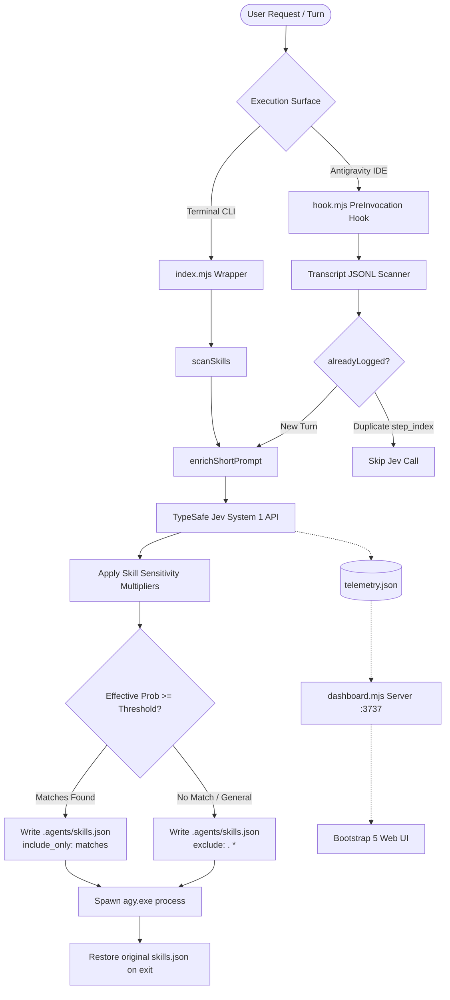

# Architecture & Design Specifications (`agy-smart`)

**Antigravity System One (`agy-smart`)** is a lightweight, zero-dependency intelligence router designed to sit in front of the **Google Antigravity CLI (`agy`)**.

This document details the architectural components, execution lifecycles, routing algorithms, and data structures.

---

## 1. Design Philosophy: System 1 vs. System 2

Modern coding agents usually run on heavy reasoning models (System 2, such as Gemini 1.5 Pro, Claude 3.5 Sonnet, or o1). While these models excel at complex reasoning, using them to inspect and select from 50+ skills on every turn causes significant context bloat and latency.

`agy-smart` applies Daniel Kahneman's Dual-Process cognitive theory to agent tooling:

| Attribute | System 1 (`agy-smart` / TypeSafe Jev) | System 2 (`agy` Primary Agent) |
| :--- | :--- | :--- |
| **Cognitive Role** | Fast, intuitive classification & filtering | Deep code comprehension & execution |
| **Response Latency** | **300ms – 700ms** | 5s – 45s+ |
| **Output Type** | Calibrated typed probabilities (`Noul`) | Natural language, tool calls, code diffs |
| **Context Overhead** | Zero skill content loaded into LLM | Only the specifically matched skills |
| **Cost** | Ultra-low token overhead | High-value generation tokens |

---

## 2. Core System Architecture



---

## 3. Component Breakdown

### 3.1. CLI Core (`index.mjs`)
- **Flag Parser (`parseFlags`)**: Separates wrapper-level flags (`--verbose`, `--dry-run`, `--dashboard`) from standard `agy` arguments (`-p`, `-i`, `--effort`).
- **Prompt Extractor (`extractUserPrompt`)**: Safely parses the user's intent across all flag variations.
- **Skill Discovery Engine (`scanSkills`)**:
  - Hierarchically searches `.agents/skills` (workspace), `~/.agents/skills` (global user), and `~/.gemini/config/skills` (global config).
  - Parses YAML frontmatter (`name`, `description`).
  - **Defensive Fallback**: If a skill's description contains placeholder text (e.g. `"One sentence - what this skill does"`), it automatically extracts the first paragraph from the markdown body to prevent router hallucinations.
- **Dynamic Config Lifecycle (`createSkillsConfig` & `restoreSkillsConfig`)**:
  - Dynamically creates or updates `.agents/skills.json`.
  - When matching skills are selected, configures `include_only: [matchedSkills]`.
  - In general mode, configures `exclude: [".*"]`.
  - Registers cleanup handlers on `process.on('exit')`, `SIGINT`, `SIGTERM`, and `uncaughtException` to guarantee workspace integrity.

### 3.2. IDE PreInvocation Hook (`hook.mjs`)
- Integrates directly with Antigravity IDE without altering user CLI habits.
- Reads execution metadata over `stdin` (`transcriptPath`).
- **`stepIndex` Deduplication**: Antigravity IDE invokes hooks on every tool call cycle. `hook.mjs` checks `step_index` so Jev is only evaluated once per user prompt, avoiding duplicate API calls during multi-step tool execution.

### 3.3. Web Performance Dashboard (`dashboard.mjs`)
- Single-file native Node.js HTTP server (defaults to port `3737`).
- Zero build tools or npm dependencies; renders a responsive Bootstrap 5 interface.
- Real-time SVG speedometer gauges for latency, token efficiency, and cumulative savings.
- Interactive **Installed Skills Catalog & Routing Matrix** with real-time sensitivity sliders and one-click test queries.

---

## 4. Routing Algorithms & Mathematical Models

### 4.1. Parallel Noul Formulation
Instead of generating text, `agy-smart` compiles all candidate skills into parallel typed `Noul` questions:
```json
{
  "state": "<Enriched User Prompt>",
  "model": "jev-latest",
  "questions": {
    "<skill-name>": {
      "type": "noul",
      "instructions": "Is this skill relevant to the user's request?",
      "criteria": {
        "true": "<Skill Description>",
        "false": "Not relevant to the user's request"
      }
    }
  }
}
```

### 4.2. Hybrid Context-Aware Turn Enrichment
Short conversational follow-ups (e.g. `"continue"`, `"fix this"`, `"next"`) naturally lack domain keywords. Without context, routers mistakenly drop into `general_mode`.

`enrichShortPrompt(prompt, prevContext)` evaluates:
1. Is prompt word count $< 8$, OR
2. Does prompt match conversational triggers: `^(continue|next|more|fix|why|redo|go on|proceed|ok|yes|what else)`?

If true, state is enriched:
$$\text{State} = \text{"[Previous Topic: \""} + \text{prevContext} + \text{"\"] Current Request: \"" } + \text{prompt} + \text{"\""}$$

### 4.3. Skill Sensitivity Multipliers (`skillWeights`)
Users can configure per-skill multipliers ($0.5\times$ to $1.5\times$) in `agy-smart.config.json` to prioritize favored frameworks or dampen noisy skills.

The effective probability $P_{\text{eff}}$ is computed as:
$$P_{\text{eff}} = \min\left(\frac{\operatorname{round}(P_{\text{raw}} \times W \times 100)}{100},\; 1.0\right)$$
where $W \in [0.1, 2.0]$ is clamped from `config.skillWeights[skillName] ?? 1.0`.

A skill is included if:
$$P_{\text{eff}} \ge \text{threshold}$$
Candidates are sorted descending by $P_{\text{eff}}$ and sliced to $\text{maxSkills}$.

---

## 5. Security & Isolation Invariants

1. **API Key Isolation**: `TYPESAFE_API_KEY` is loaded strictly into local memory via Node's native `process.loadEnvFile`. It is never written to telemetry, logs, or git-tracked files.
2. **Process Sandboxing**: The child process (`agy.exe`) inherits standard I/O streams directly (`stdio: "inherit"`), preserving all native terminal TUI features, interactive prompts, and ANSI formatting.
3. **Graceful Degradation**: If the network times out ($>2000\text{ms}$) or the API key is missing, `agy-smart` logs a warning and launches `agy` unhindered with default skill configurations.
